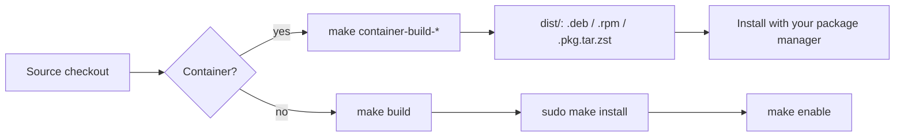

# Building from source

Two ways: in a **container** (recommended: nothing to install on your machine but Podman or
Docker, and the result is a real distro package) or **bare metal** with the `Makefile`.



```bash
git clone https://github.com/elegos/Linux-Arctis-Manager.git
cd Linux-Arctis-Manager
```

## In a container (recommended)

You need `podman` (preferred) or `docker`; the `Makefile` picks whichever it finds
(`CONTAINER_ENGINE=docker` to force one). Each target builds the real package for one distro
family and drops it, with the `-lang`, `-plasma-widget` and `-gnome-extension` sub-packages, into
`dist/`:

| Target | Builds | Base image (override with `BASE_IMAGE=`) |
|---|---|---|
| `make container-build-debian-deb` | `.deb` | `debian:stable-slim` |
| `make container-build-ubuntu-deb` | `.deb` | `ubuntu:24.04` |
| `make container-build-rpm` | `.rpm` | Fedora (`FEDORA_VERSION=`) |
| `make container-build-pkg` | `.pkg.tar.zst` | `archlinux:latest` |
| `make container-build-all` | all of the above | |

> [!IMPORTANT]
> Build on the image that matches the system you will install on. The package links against that
> distro's libraries, so a `.deb` built on Ubuntu 24.04 may not install or run on Debian.
> Pick the release explicitly when it isn't the default:
>
> ```bash
> make container-build-debian-deb BASE_IMAGE=debian:trixie-slim
> make container-build-ubuntu-deb BASE_IMAGE=ubuntu:26.04
> ```

Then install what you built:

```bash
sudo apt install ./dist/linux-arctis-manager_*.deb        # Debian / Ubuntu
sudo dnf install ./dist/linux-arctis-manager-*.rpm        # Fedora
sudo pacman -U dist/linux-arctis-manager-*.pkg.tar.zst    # Arch
```

and enable the services as described in [Installing](install.md).

> [!NOTE]
> The build runs as an unprivileged `builder` user inside the container, with the same UID/GID as
> you, so the files in `dist/` are yours. Root is only used to install the build dependencies, which
> come straight from the packaging recipe (`debian/control`, the RPM spec, the PKGBUILD). On
> rootless Podman the `Makefile` adds `--userns=keep-id` for this. If `dist/` already holds files
> that a previous root build created, remove them first or the copy fails with *Permission denied*.

The `.deb` build mirrors the CI job, so what you get is what a release ships. The Debian and Ubuntu
images are not cached between runs, so every run re-installs the build dependencies; Fedora and Arch
keep a cached base image (`make container-refresh-fedora`, `-arch` or `-all` to refresh it).

## Bare metal

Fedora/Bazzite users: prefer the [COPR packages](install.md#fedora-copr). Building straight from
source with the provided `Makefile` is for everyone else.

### Prerequisites

- [`cargo`/`rustc`](https://rustup.rs/) (stable toolchain)
- [`uv`](https://docs.astral.sh/uv/getting-started/installation/)
- Python 3.10+
- `libcap` (for `setcap`), usually already installed
- Kernel headers for `hidraw`/`udev`: `libudev-dev` (Debian/Ubuntu), `systemd-devel` (Fedora),
  `udev` (Arch, already present)

### Install

```bash
make build            # cargo build --release + uv sync
sudo make install     # installs binaries, systemd units, desktop entries; applies setcap
make enable           # enable + start lam-hidraw-helper and lam-daemon (no sudo)
```

`make install` accepts the usual `PREFIX`/`DESTDIR` overrides. See `make help` for the full
variable list, or the packaging recipes in `packaging/arch/PKGBUILD` and
`packaging/fedora/linux-arctis-manager.spec` for reference.

> [!WARNING]
> `PREFIX` defaults to `/usr/local`, not `/usr` (the prefix of the AUR/COPR/`.deb` packages). The
> two installs coexist on disk without file conflicts, but you end up with two separate sets of
> binaries, systemd units and desktop entries. [Uninstall](uninstall.md) one before installing the
> other rather than running both side by side.

On KDE Plasma 6 and GNOME Shell 45+, `make install` also installs the Plasma widget and the GNOME
Shell extension; see [Desktop integration](install.md#desktop-integration).
