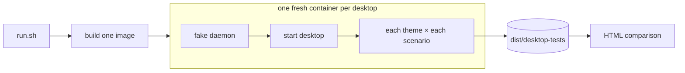

# Desktop environment testing

Screenshot tests of how the app looks on several desktop environments, run in containers.
Nothing is installed on your machine and your session is not touched. You need Podman or Docker,
Python 3, and a browser for the report.

```sh
make desktop-test                # every desktop, one after the other
make desktop-test DE=kde         # only one: cinnamon, gnome or kde
make desktop-test XEPHYR=1       # watch the X11 desktops in a window
tests/desktop/run.sh --no-open cinnamon kde   # a selection, without opening the report
```

The report opens when the run ends: `dist/desktop-tests/index.html` compares the latest run of
every desktop side by side. Each run also keeps its own gallery and logs in
`dist/desktop-tests/<desktop>/<timestamp>/`.

> [!NOTE]
> The tests only take screenshots: **you** judge them. A run fails when the desktop, the app or
> a widget does not start, not when something looks wrong.

> [!IMPORTANT]
> KDE and GNOME need a GPU render node (`/dev/dri/renderD128`), which is passed to the
> container. Cinnamon does not.

> [!WARNING]
> `XEPHYR=1` needs Xephyr on the host. It starts it **without access control** (`-ac`) on a new
> display, so other local users can connect to that window while the run lasts. Your own session's
> display is not shared. Only Cinnamon is shown: KDE and GNOME are Wayland sessions and always
> run headless.



> [!NOTE]
> These tests are local and on request only: CI does not run them, and a plain `pytest` skips
> `tests/desktop`. The unit tests of the tooling itself run with `uv run pytest tests/desktop`.

## What is tested

The scenarios are the same on every desktop:

| Scenario | Screenshots |
|---|---|
| `1-launcher` | icon of the `.desktop` shortcut: on the panel or dock, and in the menu or search |
| `2-tray-legacy` | `lam-gui --systray`: tray area and, except on KDE, its menu |
| `3-tray-native` | the desktop's own widget: tray area and popup |
| `4-gui` | main window |

## Desktops

All come from the same Fedora 45 image.

| Desktop | Session | Legacy tray through | Native widget |
|---|---|---|---|
| `cinnamon` | X11 (Xvfb or Xephyr) | built-in applet | none |
| `kde` | Wayland (`kwin_wayland --virtual`) | built-in system tray | [Plasma widget](../packaging/plasma6/) |
| `gnome` | Wayland (`gnome-shell --headless`) | AppIndicator extension | [GNOME extension](../packaging/gnome-shell/) |

Every scenario runs in each of these themes:

| Theme | Meaning | Cinnamon | KDE | GNOME |
|---|---|---|---|---|
| `light` | light panel and applications | Mint-Y | Breeze | `prefer-light` |
| `dark` | dark panel and applications | Mint-Y-Dark | Breeze Dark | `prefer-dark` |
| `mixed` | dark panel, light applications | Mint-Y-Dark panel, Mint-Y apps | Breeze Twilight | `default` |

Each run logs the colour scheme applications are told about (`portal color-scheme` in
`session.log`: 1 dark, 2 light, 0 no preference), and the app logs record which Qt platform theme
was loaded: use them to tell a bug in the app from a gap in the test environment.

## Limits

This is an approximation of a real installation:

- The daemon is replaced by a stub serving made-up status and settings
  ([`sample_data.py`](../tests/desktop/common/sample_data.py)); there is no device.
- There is no login manager, and logind is mocked.
- Distribution-specific settings (for example a Qt platform theme) are absent.
- The Plasma popup is shown in a window of its own (`plasmawindowed`), as nothing can click on the
  panel. For the same reason there is no screenshot of the legacy tray menu on KDE.
- When the GNOME extension does not declare the running GNOME release, the version check is
  disabled and the run logs a warning.

## Adding a desktop

1. Add its packages to `tests/desktop/Dockerfile`.
2. Create `tests/desktop/desktops/<name>.sh`, sourced inside the container.

| Function | Purpose |
|---|---|
| `de_start` | bring the display and desktop up, return once usable |
| `de_themes` / `de_apply_theme NAME` | list and switch theme variants (use `light`, `dark`, `mixed`, so rows line up) |
| `de_tray_region` / `de_launcher_region` | tray and shortcut areas as `WxH+X+Y` |
| `de_show_launcher` / `de_hide_launcher` | show and close the menu or search with the app in it |
| `capture_screen FILE` | optional: grab the screen, needed on Wayland (default is X11) |
| `de_show_shortcut` / `de_hide_shortcut` | optional: when the shortcut is not always visible |
| `de_open_tray_menu` / `de_close_tray_menu` | optional: menu of the legacy tray icon |
| `de_enable_native` / `de_disable_native` | optional: the desktop's own widget |
| `de_open_native` / `de_close_native` | its popup (required with the two above) |

The helpers are in [`lib.sh`](../tests/desktop/common/lib.sh).
