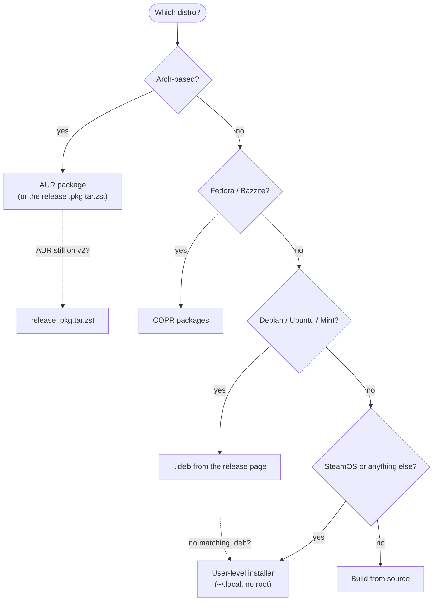

# Installing Linux Arctis Manager

The README has the short version of each method; this page has the details. Pick the method that
fits your distribution:



> [!NOTE]
> While every v3 release is still a pre-release (`v3.0.0-betaN`), GitHub's `releases/latest` alias
> does not point at them. Wherever a method below says "latest", the pre-release notes tell you
> what to use instead. Once the first stable release is out, the plain commands just work.

## User-level installer (SteamOS and any distro)

Installs everything under `~/.local` (and `~/.config` for the systemd user units), from signed
prebuilt binaries. It also works on SteamOS, whose read-only root filesystem rules out normal
packages.

```bash
curl --proto '=https' --tlsv1.2 -fsSL https://github.com/elegos/Linux-Arctis-Manager/releases/latest/download/install.sh | sh
```

> [!IMPORTANT]
> **Until the first stable release**, that URL returns *404*: `releases/latest` only ever points at
> a non-pre-release, and every v3 release so far is a pre-release. Download the installer from a
> specific tag instead (take the newest tag from the
> [releases page](https://github.com/elegos/Linux-Arctis-Manager/releases)) **and** pass
> `--pre-release`, otherwise the installer finds no stable release to install:
>
> ```bash
> TAG=v3.0.0-beta3   # the newest tag on the releases page
> curl --proto '=https' --tlsv1.2 -fsSL "https://github.com/elegos/Linux-Arctis-Manager/releases/download/$TAG/install.sh" | sh -s -- --pre-release
> ```
>
> The tag only decides which copy of `install.sh` you run; `--pre-release` decides which release it
> installs (the newest one, pre-releases included).

Options (after `sh -s --`):

| Option | Effect |
|---|---|
| *(none)* | Install, or upgrade if already installed |
| `--pre-release` | Include pre-releases (required today, see above) |
| `--version X.Y.Z` | Pin a specific version |
| `--dry-run` | Only verify and check prerequisites, change nothing |
| `--diagnose` | Print a report to paste into a bug report |
| `uninstall` | Remove everything it installed (`--purge` also deletes your settings) |

- The release checksums are signed (SSH signature) and verified before anything is run. Every
  security-relevant step is announced and waits for you to press Enter (or Ctrl+C to abort); the
  only step needing root is giving the HID helper its capability (`setcap`), via `pkexec`/`sudo`.
- Needs `systemd` (user session), `libpulse`, a PipeWire/PulseAudio server and glibc >= the version
  shown by `--dry-run`. If something is missing the installer stops before changing anything and
  tells you what.

### Verifying a release by hand

Releases are signed with this SSH key (`lam-release`), fingerprint:

```
SHA256:ACwAZQm1Pfgrg2gv3CpS7jShGtASZKgmlaCYGsFoDA0
```

`SHA256SUMS` lists every file attached to the release: the tarballs, the distro packages and
`install.sh`. `install.sh` checks its signature and then the tarball's checksum before extracting or
running anything. To do the same yourself (swap the tarball for the package you downloaded, if you
installed one):

```bash
V=https://github.com/elegos/Linux-Arctis-Manager/releases/download/<tag>
curl -fsSLO $V/SHA256SUMS -O $V/SHA256SUMS.sig -O $V/lam-<version>-x86_64-generic.tar.gz   # or the .deb/.rpm/.pkg.tar.zst you want
echo 'lam-release namespaces="lam-release" ssh-ed25519 AAAAC3NzaC1lZDI1NTE5AAAAIGEJRaTQKrVoLHoNLxtYs4s5TXt6KILaEEElIi83LYfH' > allowed_signers
ssh-keygen -Y verify -f allowed_signers -I lam-release -n lam-release -s SHA256SUMS.sig < SHA256SUMS
sha256sum -c --ignore-missing SHA256SUMS
```

The `ssh-keygen` command must print `Good "lam-release" signature` with the fingerprint above. The
installer itself is only protected by TLS (it is the root of this chain), so you can download
`install.sh` from the release page and read it before running it.

## Arch Linux (AUR)

Install the community-maintained package from the
[Arch User Repository](https://aur.archlinux.org/packages/linux-arctis-manager) with your preferred
AUR helper:

```bash
yay -S linux-arctis-manager
# or: paru -S linux-arctis-manager
```

The package's post-install hook applies the required capability to `lam-hidraw-helper` and prints
the two commands to enable the services:

```bash
systemctl --user daemon-reload
systemctl --user enable --now lam-hidraw-helper.service lam-daemon.service
```

> [!NOTE]
> If the AUR package is still on v2, install the `linux-arctis-manager-*.pkg.tar.zst` attached to
> the release page instead (`sudo pacman -U <file>`; add the `-lang`, `-plasma-widget` or
> `-gnome-extension` packages if you want them) and check it against `SHA256SUMS`, see
> [Verifying a release by hand](#verifying-a-release-by-hand).

For packaging-specific issues, report directly to the AUR maintainers:
[@tonitch](https://aur.archlinux.org/account/tonitch) and
[@Aiyahhh](https://aur.archlinux.org/account/Aiyahhh).

## Fedora (COPR)

Prebuilt RPM packages are published on [COPR](https://copr.fedorainfracloud.org/), split into two
channels:

- `elegos/linux-arctis-manager` - stable, tagged releases only
- `elegos/linux-arctis-manager-testing` - every alpha/beta/rc build, ahead of stable

> [!IMPORTANT]
> **Until the first stable release, use the testing channel.** The stable channel only receives
> tagged non-pre-release versions, so it is still empty and `dnf install` from it finds nothing.
> Every v3 release so far is a pre-release and lands in `-testing`.

```bash
sudo dnf copr enable elegos/linux-arctis-manager-testing
sudo dnf install linux-arctis-manager
```

Once a stable release is out, switch to the stable channel with
`sudo dnf copr enable elegos/linux-arctis-manager` (disable the testing one first:
`sudo dnf copr disable elegos/linux-arctis-manager-testing`).

Optionally add whichever UI shell(s) you want, on top of the main package:

```bash
sudo dnf install linux-arctis-manager-plasma-widget    # KDE Plasma 6 widget
sudo dnf install linux-arctis-manager-gnome-extension  # GNOME Shell 45+ extension
```

The package's post-install scriptlet applies the required capability to `lam-hidraw-helper`, so
just enable the services:

```bash
systemctl --user daemon-reload
systemctl --user enable --now lam-hidraw-helper.service lam-daemon.service
```

## Debian, Ubuntu and derivatives

Each release page carries a `.deb` per supported distro (Debian, Ubuntu, Linux Mint); the file name
says which one. Download the one matching your system, then install it with `apt` so dependencies
get resolved:

```bash
sudo apt install ./linux-arctis-manager_<version>+<distro>-1_amd64.deb
```

Optionally add `linux-arctis-manager-lang`, `linux-arctis-manager-plasma-widget` and
`linux-arctis-manager-gnome-extension` the same way. The `postinst` applies the required capability
to `lam-hidraw-helper`; then enable the services:

```bash
systemctl --user daemon-reload
systemctl --user enable --now lam-hidraw-helper.service lam-daemon.service
```

Check the download against `SHA256SUMS` as shown in
[Verifying a release by hand](#verifying-a-release-by-hand). No `.deb` for your distro? Use the
[user-level installer](#user-level-installer-steamos-and-any-distro) or
[build one yourself](build-from-source.md#in-a-container-recommended).

## Desktop integration

> [!TIP]
> To launch the system tray app automatically on login:
>
> ```bash
> ln -sf /usr/share/applications/ArctisManagerSystray.desktop ~/.config/autostart/
> # or, if installed with PREFIX=/usr/local:
> ln -sf /usr/local/share/applications/ArctisManagerSystray.desktop ~/.config/autostart/
> ```

- **KDE Plasma 6:** the `linux-arctis-manager-plasma-widget` package (or `make install`, from
  source) adds a native widget that talks to the daemon over D-Bus, with no separate tray process.
  Add it like any other widget ("Add Widgets..." → "Arctis Manager"); right-click it for its
  Configure dialog to pick which status fields and quick settings it shows.
- **GNOME Shell 45+:** `linux-arctis-manager-gnome-extension` (or `make install`) adds an equivalent
  extension. Enable it with the Extensions app, or
  `gnome-extensions enable arctis-manager@giacomofurlan.name`; its Preferences page picks which
  status fields and quick settings it shows.

## Next

- [Build from source](build-from-source.md) · [Uninstall](uninstall.md)
- Something not working? See the [troubleshooting notes](../README.md).
